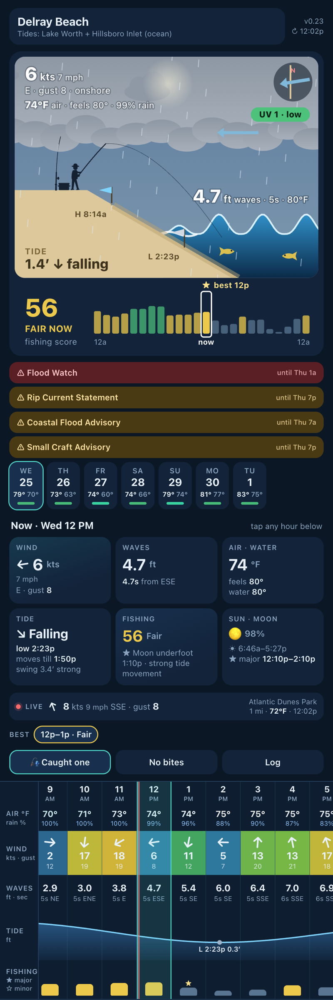

# SureCast

Shore-fishing conditions on one screen, built around the beaches of South Florida: wind, waves, tide, water temperature, weather
alerts and a 0 to 100 fishing score for every hour. It runs as an iPhone app and as a web page from the same code.

**Live:** https://occhiphoto.com/surecast/

## What's on the screen

- **The beach scene** (`SureCast/web/hero.js`) is drawn live for the selected hour: wind streaks from the real
  direction and speed, waves to scale against a 6 ft angler, the water line between the high and low tide flags, rain,
  and more fish the better the score.
- **Fishing score:** tide movement 35, dawn and dusk 20, solunar periods up to 15, moon phase 5, on a base of 25,
  minus penalties for wind, rough surf, heavy rain and thunderstorms. Tide movement is rated against the current
  spring-neap cycle, so a "strong" tide means strong for this week, not in general.
- **Hour by hour:** tap any hour to see that hour's wind, waves, tide, air and water temperature, and score.
- **Live wind** from the nearest weather station, falling back to the nearest NOAA station.
- **Weather alerts** from the National Weather Service, shown as soon as they're issued.
- **Tides that fit the beach:** spots between Lake Worth Pier and Hillsboro Inlet blend the two ocean tide stations by
  how far north or south they sit, instead of taking the nearest station, which is often on the Intracoastal.
- **Fishing log:** tap *Caught one* or *No bites* and the conditions at that moment are saved with it, so the score
  can be checked against what actually happened. Logs can be shared with friends, and reading them needs a code.

## Where the data comes from

| Data | Source |
| --- | --- |
| Wind, air temperature, rain | Open-Meteo forecast |
| Waves, swell period, water temperature | Open-Meteo Marine |
| Tide predictions and stations | NOAA CO-OPS |
| Weather alerts | National Weather Service |
| Live wind and air temperature | WeatherSTEM (Florida Severe Weather Network) station, via the Worker |
| Sun and moon | SunCalc, in the page |

All of it is fetched by the page itself except the live station, which needs an API key. That goes through a small
Cloudflare Worker (`worker/src/worker.js`), so the key never reaches the browser, and the Worker caches each reading
for two minutes, so the station sees one request however many people have the page open. The station is fixed in
the code on purpose, so the Worker can't be used as an open proxy for the key.

The page keeps the last few spots' data on the phone, so it still opens with recent numbers when signal is bad at
the beach.

## The iPhone app

`SureCast/SureCastApp.swift` is a SwiftUI shell around the bundled web dashboard. Swift supplies two things the web
view can't do reliably on its own: the phone's location, and a nightly 8 PM notification with tomorrow's best
fishing times, which the page works out and hands over. The Xcode project is generated from `project.yml` with
XcodeGen.

`scripts/phones.sh` installs the app on a phone and, run hourly, rebuilds and reinstalls it before Apple's free
7-day signing runs out, so a personal build never just stops opening.

## Shared fishing logs

Friends' logs live in one Cloudflare Durable Object. Each phone gets a random sender ID, which is the only thing that
can write to its entries; IDs are never sent back out. Every entry is checked field by field before it's stored, and
there are caps on body size, senders and entries. Reading needs the code (a Worker secret), compared in a way that
doesn't leak how much of a wrong code was right.

## Credits

Sun and moon positions use [SunCalc](https://github.com/mourner/suncalc) by Vladimir Agafonkin (BSD 2-Clause,
see `SureCast/web/SUNCALC-LICENSE.txt`).

## Not for navigation

Forecasts only. Check official marine forecasts before going out.
